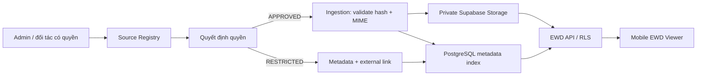

# EWD Library — kiến trúc hệ thống

## Mục tiêu và ranh giới

EWD Library mở rộng Garage Atlas bằng một catalog sơ đồ điện mobile-first. Nó lưu metadata và provenance cho mọi nguồn; chỉ các artifact `APPROVED` mới được đưa vào Supabase Storage, lập chỉ mục nội dung hoặc trình bày trong viewer nội bộ. Artifact hạn chế dùng `external_link` và mở thẳng trang gốc.

## Mô hình dữ liệu mở rộng

Các bảng hiện có `source_registry`, `documents`, `document_files`, `manufacturers`, `vehicle_models`, `vehicle_variants`, `document_categories`, `document_licenses` và `user_bookmarks` vẫn là lõi. Migration EWD bổ sung:

| Bảng | Mục đích chính |
| --- | --- |
| `ewd_systems` | Cây electrical system chuẩn hóa: code, tên, parent. |
| `ewd_artifacts` | Một trang/sơ đồ/view cụ thể; `artifact_type`, `format`, `display_mode`, `original_url`, vehicle scope và trạng thái kiểm duyệt. |
| `ewd_relations` | Liên kết sơ đồ liên quan: `continues_to`, `references_connector`, `references_ground`, `references_ecu`, `uses_wire_color`. |
| `ecu_pinouts` | Metadata terminal ECU: module, connector, pin, signal, direction, wire color, review status. |
| `connector_views` | Connector ID, vị trí, số chân, hình/asset đã duyệt. |
| `ground_locations` | Ground ID, vị trí, mô tả, artifact nguồn. |
| `wire_color_codes` | Mã màu chuẩn theo nguồn/nhà sản xuất, primary/tracer/color label. |

`ewd_artifacts` có các hàng rào bắt buộc: artifact `link_only` không có `storage_path`; artifact nội bộ phải tham chiếu `document_file` đã được duyệt và nguồn `APPROVED` có quyền storage + redistribution. Chỉ metadata có bằng chứng mới điền manufacturer/model/year/engine/system. Các trường thiếu dữ liệu giữ `NULL` và gắn `needs_admin_review`.

## Viewer mobile-first

Viewer dùng canvas/SVG stage có vùng thao tác lớn, điều hướng đáy và safe-area. Tương tác gồm pinch zoom, kéo để pan, nút zoom/reset, fullscreen, bookmark local/user, danh sách sơ đồ liên quan và panel kỹ thuật cho pinout/connector/ground/color code. PDF dùng PDF.js khi file đã được duyệt; SVG render native để nét khi zoom; ảnh dùng image stage; HTML được sandbox hoặc hiển thị link-out theo policy. Không render nội dung từ nguồn `RESTRICTED` qua proxy.

## Quyền, bảo mật và vận hành

- Supabase RLS chỉ cấp URL Storage cho `documents.status=published`, `document_files.review_status=approved`, `view_allowed=true`, và license/source cho phép phát hành.
- Source Registry giữ URL gốc, terms, robots, kiểm tra lần cuối, allowlist domain/path, trạng thái và audit reviewer.
- Ingestion xác thực MIME/magic number, hash SHA-256, kích thước, provenance và retry; chỉ chạy khi source được duyệt để crawl/lưu trữ/tái phân phối.
- Không dùng service key ở web client. Publishable key chỉ đọc các dữ liệu RLS công khai được phê duyệt.

## Tương thích hiện có

Module được thêm dưới `/mvp/ewd/`, không thay thế màn hình tìm kiếm, DTC, bookmark hoặc admin hiện tại. Dữ liệu demo của EWD do dự án tự tạo, được đánh dấu sample; không đại diện cho tài liệu OEM hoặc nội dung lấy từ các nguồn tham khảo.
