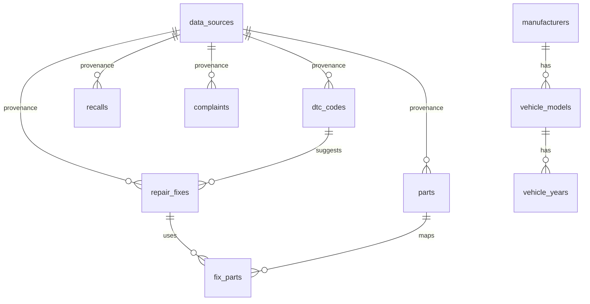

# Schema dữ liệu phụ tùng và sửa chữa

`manufacturers`, `vehicle_models`, `vehicle_variants`, `dtc_codes` và `data_sources` đã có từ schema gốc. Migration `0005_open_repair_data.sql` mở rộng chúng và thêm các bảng dưới đây.

| Bảng | Nội dung | Provenance |
| --- | --- | --- |
| `vehicle_years` | Năm, trim, engine, fuel, transmission cho một model | `source_id` bắt buộc |
| `repair_fixes` | Cách sửa xếp hạng, độ khó, chi phí USD, giờ công | `source_id` bắt buộc |
| `parts` | Tên VN/EN, nhóm, OEM number, trạng thái dịch | `source_id` bắt buộc |
| `fix_parts` | Quan hệ cách sửa – phụ tùng | kế thừa từ fix/part |
| `recalls` | Campaign, xe, component, summary, consequence, remedy | `source_id` bắt buộc |
| `complaints` | ODI, xe, component, summary, ngày | `source_id` bắt buộc |
| `vehicle_specs` | Torque, fluid capacity hoặc interval | `source_id` bắt buộc |
| `data_sync_cache` | Cache API, ETag/URL/hash và hạn dùng | `source_id` bắt buộc |
| `parts_contributions` | Dữ liệu VN do admin/gara nhập, `contributed_by`, `verified` | source `admin_contribution` |

`data_sources` được mở rộng với `license`, `attribution_text`, `commercial_ok`, `redistribution_ok`, `last_fetched_at` và `license_review_status`. Dữ liệu có `license_review_status='unknown'` không được public policy đọc.

